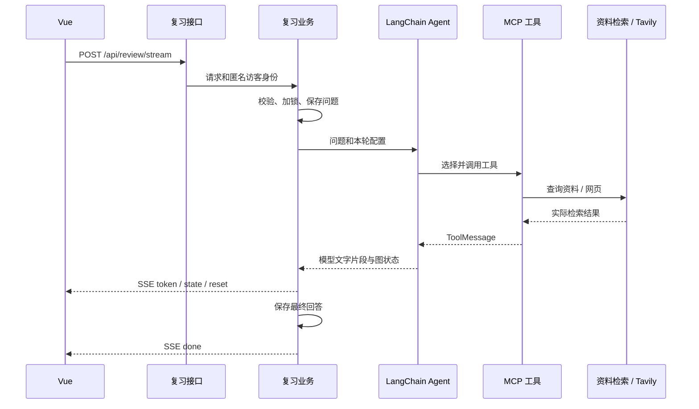

# 小晗后端开发与学习指南

这是一个使用 LangChain 1.x 的学习工具。前端上传资料，后端切分并向量化；用户提问后，Agent 通过 MCP 检索资料，在允许联网时补充网页信息，最后把答案流式返回给前端。

建议先沿着下面两条流程读代码，再看后台和身份模块。每一层只负责自己的工作，不必一次读完整个后端。

## 目录与职责

```text
backend/
├── app/
│   ├── main.py                 # FastAPI 装配入口，不放具体业务
│   ├── core/
│   │   ├── config.py           # .env、路径、模型、RAG、搜索和后台参数
│   │   ├── lifespan.py         # 启动/关闭数据库连接及 Checkpointer
│   │   └── errors.py           # 面向页面的中文错误提示
│   ├── api/
│   │   ├── dependencies.py     # 从请求读取匿名访客身份
│   │   └── routes/
│   │       ├── system.py       # 健康检查、匿名缓存标识
│   │       ├── materials.py    # 资料上传/导入/删除、检索
│   │       ├── review.py       # JSON 回答和 SSE 回答接口
│   │       ├── conversations.py # 历史会话接口
│   │       └── admin.py        # 管理员登录、查询问答记录
│   ├── schemas/
│   │   ├── review.py           # ChatRequest、SearchRequest
│   │   └── admin.py            # LoginRequest
│   ├── services/
│   │   ├── materials.py        # 协调加载、切分、向量化和登记
│   │   ├── review.py           # 一轮问答、历史保存、SSE、中断处理
│   │   ├── conversations.py    # 归属校验、历史查询、删除流程
│   │   └── locks.py            # 生成和删除共享的会话锁
│   ├── agents/
│   │   ├── review.py           # create_agent、ainvoke、astream
│   │   ├── prompts.py          # 默认角色与每轮动态检索规则
│   │   ├── middleware.py       # 工具路由、工具失败和中断恢复
│   │   ├── messages.py         # 从 LangChain 消息整理答案、引用和过程
│   │   └── memory.py           # PostgreSQL / 内存 Checkpointer
│   ├── rag/
│   │   ├── loaders.py          # PDF、DOCX、文本、Notebook → 纯文本
│   │   ├── chunking.py         # RecursiveCharacterTextSplitter → Document
│   │   ├── embeddings.py       # 百炼 / 本地 Embeddings 实现
│   │   └── vector_store.py     # Milvus 集合、维度检查与索引初始化
│   ├── repositories/
│   │   ├── database.py         # PostgreSQL 连接池与表初始化
│   │   ├── conversations.py    # 会话/消息 SQL、旧 checkpoint 历史恢复
│   │   ├── admin.py            # 后台会话和问答表格 SQL
│   │   └── materials.py        # SQLite 资料登记 SQL
│   ├── integrations/
│   │   ├── web_search.py       # Tavily 请求与结果清洗
│   │   └── mcp/
│   │       ├── client.py       # MultiServerMCPClient 的 stdio 配置
│   │       └── server.py       # FastMCP 工具和 Prompt 定义
│   ├── security/
│   │   ├── visitors.py         # 匿名 Cookie、访客摘要、隔离记忆编号
│   │   ├── admin.py            # 后台鉴权、同源检查和登录限流
│   │   ├── passwords.py        # scrypt 密码摘要
│   │   ├── headers.py          # 后台响应禁止缓存
│   │   └── client_info.py      # 可信代理、IP 和协议识别
│   ├── admin_setup.py          # 管理员账号交互配置命令
│   └── mcp_server.py           # 保留原 MCP 启动命令的兼容入口
├── tests/                      # 单元测试与 PostgreSQL 集成测试
├── data/                       # Milvus Lite、SQLite 登记库
└── uploads/                    # 上传文件
```

## 第一次建议怎么读

1. 看 `schemas/review.py`：理解前端传来的问题、资料 ID、学习模式和联网开关。
2. 看 `api/routes/review.py`：接口只把请求交给业务层，并设置 SSE 响应头。
3. 看 `services/review.py`：校验资料及会话归属、保存问题、调用 Agent、保存回答。
4. 看 `agents/review.py`：用 `create_agent` 组合模型、工具、Prompt、Middleware 和 Checkpointer。
5. 看 `integrations/mcp/server.py`：工具调用资料检索接口，或者调用 Tavily 查询网页。
6. 最后看 `agents/middleware.py` 和 `agents/messages.py`：理解异常恢复与回答引用的来源。

代码里有两个名为 `review.py` 的模块：`services/review.py` 负责产品的一轮复习流程，`agents/review.py` 只负责 LangChain Agent 的执行。它们的边界是 `question / material_ids / study_mode` 等输入与答案/引用/过程输出。

## 流程一：上传资料如何入库


`services/materials.py` 中的 `_ingest()` 是主线。`Document.page_content` 是切片文字，Embedding 将文字变成浮点数向量，Milvus 同时保存向量、资料编号、文件名与正文，SQLite 保存供资料列表展示的文件登记信息。

检索时，`search_materials()` 将问题向量化，并用所选 `material_ids` 过滤 Milvus 的范围。只返回本轮允许使用的资料切片。

修改文件格式支持看 `rag/loaders.py`；修改切分方式看 `rag/chunking.py`；替换向量模型看 `rag/embeddings.py`。切分参数改变后需要重新导入，已有向量不会自动更新；更换模型时即使维度相同也应重新建索引，不能混用不同模型的向量。

## 流程二：问题如何变成流式回答



选中资料时先检索资料；无资料、结果为空或工具失败时，Middleware 在联网允许的情况下引导使用网页工具。返回了非空切片但与问题无关时，是否补充搜索由模型结合 `agents/prompts.py` 的规则判断，并非只要有相似度就认为找到了答案。

SSE 事件的分工：

| 事件 | 前端行为 |
| --- | --- |
| `start` | 获得用户消息的保存信息 |
| `token` | 追加回答文字 |
| `state` | 更新引用和工具调用过程 |
| `reset` | 清除检索前的临时文字，避免拼进最终答案 |
| `done` | 展示最终回答及保存结果 |
| `error` | 展示失败或中断说明 |

浏览器断开或用户停止生成时，业务层取消生成任务并尝试保存已有文字。会话生成与删除共用 `services/locks.py`，避免删除历史时另一轮仍在写入。一个问题只保存一次完整或中断的回答，不按 token 写数据库。

## 三种数据存储不要混淆

| 数据 | 放在哪里 | 负责模块 |
| --- | --- | --- |
| 资料向量与切片 | Milvus Lite 或配置的 Milvus 服务 | `rag/vector_store.py`、`services/materials.py` |
| 文件名、来源、切片数 | SQLite `materials.sqlite3` | `repositories/materials.py` |
| 前端会话列表、问答、后台登录状态 | PostgreSQL | `repositories/` |
| 模型上下文和工具调用状态 | LangGraph Checkpointer：PostgreSQL 或内存 | `agents/memory.py` |

页面历史和 Agent 记忆是两份用途不同的数据。没有 `DB_URL` 时可以用内存继续聊天，但重启后模型记忆会丢失，服务端历史列表和后台需要 PostgreSQL。匿名访客身份通过 Cookie 保持，不需要登录；手机与电脑的浏览器 Cookie 不同，因此各自拥有独立会话。

## 配置应该改哪里

外部地址与密钥放项目根目录 `.env`，只由 `core/config.py` 读取；Prompt 放 `agents/prompts.py`；参数默认值也按用途集中到 `core/config.py`。

| 目的 | 配置项 / 位置 |
| --- | --- |
| 对话模型 | `REVIEW_LLM_MODEL`、`DEEPSEEK_API_KEY`、`DEEPSEEK_BASE_URL` |
| 生成温度 | `CHAT_TEMPERATURE`，默认 `0.4` |
| 远程向量模型 | `EMBEDDING_MODEL`、`EMBEDDING_API_KEY`、`EMBEDDING_BASE_URL` 三项一起填写 |
| 本地向量模型 | `LOCAL_EMBEDDING_MODEL`，仅远程三项全空时使用 |
| 向量库地址 | `XIAOHAN_MILVUS_URI`，默认项目内 `backend/data/xiaohan.db` |
| 切片长度与重叠 | `RAG_CHUNK_SIZE=700`、`RAG_CHUNK_OVERLAP=100` |
| 网页搜索 | `TAVILY_API_KEY`；数量、超时、摘要长度默认值在配置文件搜索分组 |
| 对话数据库 | `DB_URL` |
| 后端允许的前端来源 | `CORS_ORIGINS`，多个地址逗号分隔，默认本机 `5174` |
| 上传限制 | `MAX_UPLOAD_MB=25`；调整后也需要同步前端上传说明 |
| MCP 回调后端 | `API_BASE_URL`，开发默认 `http://127.0.0.1:8010` |
| 管理员密码 | 用配置脚本生成 `ADMIN_PASSWORD_HASH`，不填写明文密码 |
| 可信反向代理 | `TRUSTED_PROXY_HOSTS`、`TRUSTED_PROXY_CIDRS` |

配置在进程启动时读取，修改后需要重启后端。目录重构没有迁移已有数据库文件，也没有更改 PostgreSQL 表名和 HTTP 地址。`main.py` 内的 `create_app()` 集中注册所有路由和中间件，新增路由模块后在此处注册。

## 以后新增功能怎么放

例如增加“根据资料生成复习卡片”：

1. 在 `schemas/` 定义卡片请求字段。
2. 在 `services/` 编写生成流程。
3. 需要模型时在 `agents/` 实现调用，提示词放 `agents/prompts.py` 或独立的卡片提示词模块。
4. 需要新工具时在 `integrations/mcp/server.py` 注册工具，具体第三方请求放 `integrations/`。
5. 需要保存卡片时在 `repositories/` 增加读写操作。
6. 在 `api/routes/` 增加接口并注册到 `main.py`，补上行为测试。

不用每次都创建所有层：只加一个字段就改现有模型与对应流程；只有职责独立、确实有复用或文件变得难读时才继续拆分。

## 启动和测试

仍然从 `backend` 目录启动：

```bash
uv sync --frozen
uv run uvicorn app.main:app --host 127.0.0.1 --port 8010 --reload --no-proxy-headers
```

接口说明在 `http://127.0.0.1:8010/docs`。Docker 的启动入口仍为 `app.main:app`，不需要因为目录重构修改 Compose 或 CI/CD。

普通测试不需要模型 Key，使用模拟模型和临时资料库；PostgreSQL 集成测试默认跳过：

```bash
uv run --frozen python -m unittest discover -s tests -v
```

使用专用测试数据库并显式启用数据库测试：

```bash
XIAOHAN_POSTGRES_TESTS=1 uv run --frozen python -m unittest discover -s tests -v
```

运行前让测试配置中的 `DB_URL` 指向测试库；本项目 `.env` 的值会覆盖进程同名环境变量，因此本机已有业务 `.env` 时不能只在命令前临时写一个 `DB_URL` 就认为隔离完成。CI 没有业务 `.env`，使用工作流里的临时 PostgreSQL。

`test_rag_pipeline.py` 验证解析、入库、重复导入、失败清理及资料范围过滤；`test_mcp_connection.py` 会启动真实 MCP stdio 子进程，只发现工具，不执行联网搜索或模型请求。
